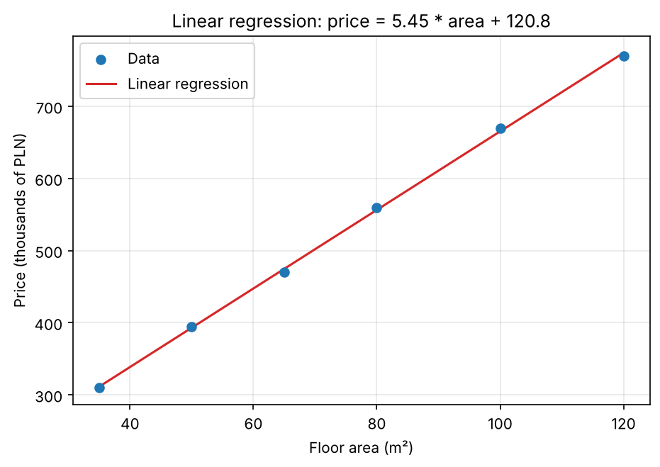

# Google Colab + Linear Regression

Predicting **apartment price (thousands of PLN)** from **floor area (m²)** with a simple linear regression in Google Colab.

## Files

| File | Description |
|------|-------------|
| `colab_regression.ipynb` | Notebook: data loading, linear regression, predictions and all exercises |
| `apartments.csv` | Data: area (m²) and price (thousands of PLN) |
| `regression.png` | Saved regression plot |
| `requirements.txt` | Dependencies for running locally |
| `.gitignore` | Ignored temporary files |

## Model

`price = a * area + b`, fitted with `LinearRegression` from scikit-learn:

- a ≈ **5.445** (each extra m² adds about 5.4 thousand PLN)
- b ≈ **120.8** thousand PLN
- R² ≈ **0.9995**, MAE ≈ **3.4** thousand PLN

Predictions: 40 m² → 338.6, 60 m² → 447.5, 80 m² → 556.4 thousand PLN.

## Exercises done

1. Added `price_per_m2` — price per m² decreases with area (≈ 8 860 → 6 420 PLN/m²).
2. Plotted area vs price per m².
3. Computed MAE, MSE, RMSE and R².
4. Added `area_m2²` as a second feature — the polynomial model has a slightly lower error (MAE 2.77 vs 3.43), but with only 6 points the linear model is enough.
5. Saved the plot to `regression.png`.

## How to run

Open `colab_regression.ipynb` in [Google Colab](https://colab.research.google.com) (**File → Upload notebook**), upload `apartments.csv` in the **Files** panel and choose **Runtime → Run all**.

Locally: `pip install -r requirements.txt`, then open the notebook in Jupyter.
